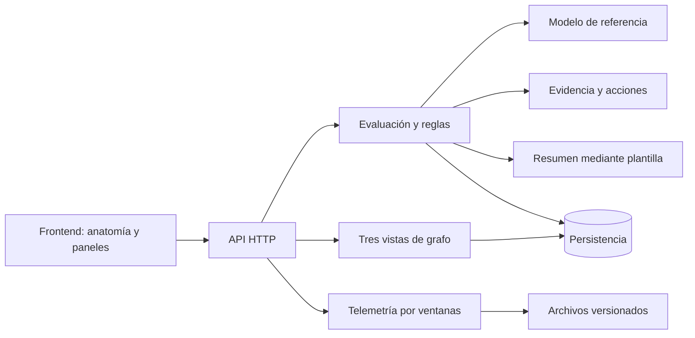

# Arquitectura propuesta

## Decisión técnica

Un frontend de navegador, una API y una base relacional. El backend se organiza en módulos dentro de un solo servicio. Esto permite compartir el mismo cálculo, procedencia y contenido entre las tres vistas del usuario.

| Parte | Elección de partida | Motivo |
| --- | --- | --- |
| Backend | Python + FastAPI + Pydantic | Cálculos y preparación de datos en Python; validación de entradas/salidas y descripción OpenAPI. |
| Frontend | React + TypeScript + Vite + Tailwind | Experiencia interactiva en navegador, con API separada y construcción de archivos estáticos. |
| Anatomía | React Three Fiber + Drei | Integrar el modelo 3D con la interacción de React. |
| Grafos | React Flow | Nodos informativos y relaciones tipadas en tres vistas contextuales. El backend entrega semántica; frontend decide posiciones. |
| Persistencia | PostgreSQL | Base principal centralizada para el despliegue en nube confirmado. Se propone un servicio administrado; proveedor pendiente. |
| Resúmenes | Plantillas en backend | Texto consistente con los mismos hallazgos que alimentan los grafos. |
| Comunicación | HTTP/JSON | Evaluaciones cortas y telemetría por ventanas. |

React es la biblioteca de interfaz y Vite la herramienta de desarrollo/construcción. Esta aplicación no requiere inicialmente renderizado en servidor. React recomienda considerar frameworks completos para necesidades más amplias; aquí elegimos una aplicación cliente por el alcance acotado y el backend separado. Si cambian esas necesidades, revisar la decisión.

Las versiones se fijarán al crear las aplicaciones. React Three Fiber debe ser compatible con la versión mayor de React elegida. No elegir versiones alpha para la demo.

## Flujo de datos

Una evaluación conserva una instantánea de observaciones, parámetros, versiones de reglas/modelo/evidencia y resultados. El resumen, escenario y grafos referencian su `assessment_id`. Cambiar el día crea una evaluación nueva; no se reinterpreta una evaluación histórica con datos posteriores.

## Módulos futuros del backend

| Módulo | Responsabilidad |
| --- | --- |
| `cases` | Caso virtual, reloj de misión, regiones e indicadores. |
| `assessments` | Hallazgos y estado completo/parcial/insuficiente. Coordina los otros módulos. |
| `simulation` | Modelo identificado y su dominio. Sin reglas médicas ni texto generado. |
| `evidence` | Fuentes, afirmaciones, ubicaciones y limitaciones. |
| `actions` | Acciones revisadas, elegibilidad y seguimiento. |
| `graphs` | Proyecciones tipadas de fundamento, escenario y acciones. |
| `telemetry` | Lectura normalizada de una grabación y entrega de ventanas. |
| `summaries` | Redacción de resultados mediante plantillas; posible adaptador de IA posterior. |

La API valida y coordina. Los cálculos científicos no deben depender del servidor HTTP, del visor o de un proveedor de IA.

## Persistencia lógica

- Casos y basales separados de referencias poblacionales.
- Observaciones y plan/registro de ejercicio con origen y método.
- Fuentes y afirmaciones con versiones y ubicación exacta.
- Definiciones de modelos y reglas con revisión científica.
- Evaluaciones y escenarios con sus entradas/resultados congelados.
- Estado de ejecución de acciones separado del texto y fundamento de la recomendación original.

Los CSV/GLB originales no se incrustan en cada evaluación. Se registran identificador, versión y localización; al importar, conservar checksum y licencia. La base de datos no contiene una fórmula implícita que una tamaño, torque y ejercicio.

## Despliegue en nube

La publicación en nube está confirmada; aún no se han contratado ni creado servicios.

- Frontend construido con Vite y publicado como archivos estáticos.
- Backend FastAPI como un servicio HTTP, inicialmente una instancia.
- PostgreSQL como base principal, también en desarrollo para mantener el mismo motor. Se propone contratarlo administrado al elegir proveedor.
- La conexión a la base se configura en el backend mediante `DATABASE_URL`; sus credenciales nunca se entregan al frontend ni se guardan en Git.
- Frontend accede únicamente a la API. Configurar su URL pública HTTPS y los orígenes permitidos por backend al preparar el despliegue.
- Conservar datasets originales en almacenamiento persistente o como recursos versionados de solo lectura, según tamaño y licencia. Los archivos que se generen durante la ejecución requieren almacenamiento persistente; no depender del disco temporal del servicio.

Queda por acordar proveedor, presupuesto, región, límites del servicio, almacenamiento de archivos y configuración de respaldo de la base. La etapa actual solo documenta estas necesidades.

## Tres vistas de un mismo conocimiento

| `view` | Relaciones esperadas |
| --- | --- |
| `evidence` | Hallazgo → observación; afirmación → fuente; interpretación → limitación. |
| `scenario` | Escenario → modelo → parámetros → trayectoria; modelo → fuentes y supuestos. |
| `actions` | Acción → hallazgo; acción → requisitos; acción → fundamento y fuente. |

Cada arista tiene tipo y texto legible. Una asociación no se etiqueta como causalidad. El layout pertenece al frontend; el significado de la conexión pertenece al backend y al contenido revisado.

## IA y funcionamiento de la demo

La IA redactora es opcional. Recibiría solo resultados estructurados y afirmaciones permitidas con identificadores; no calcularía indicadores ni decidiría acciones. Se requiere una salida alternativa mediante plantillas cuando no esté disponible. No se han seleccionado modelo, proveedor o framework de agentes.

El flujo principal debe poder usar datos locales preparados y resúmenes de plantilla. Abrir la página externa de un estudio sí requiere conexión. Esta es una condición de diseño, no una capacidad offline ya implementada.

## Fuentes oficiales de las decisiones técnicas

- [FastAPI: características y OpenAPI](https://fastapi.tiangolo.com/features/).
- [React: aplicación cliente y sus compromisos](https://react.dev/learn/build-a-react-app-from-scratch).
- [Vite: desarrollo y construcción](https://vite.dev/guide/).
- [React Three Fiber: integración y compatibilidad](https://r3f.docs.pmnd.rs/getting-started/introduction).
- [React Flow: nodos y relaciones](https://reactflow.dev/learn).
- [FastAPI: bases relacionales](https://fastapi.tiangolo.com/tutorial/sql-databases/).
